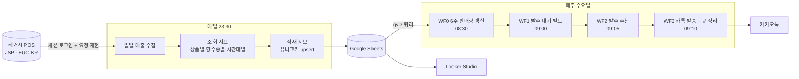

<h1 align="center">Icepop Workflow</h1>

무인 아이스크림 매장 2곳의 매출 수집 · 발주 추천 자동화 (n8n) 2026.05~ 실운영 중

<table>
<tr>
<td width="34%" align="center"> 발주 추천 카톡 (매주 수 09:10)</td>
<td width="66%" align="center"> 매출 대시보드 (금액 가림)</td>
</tr>
</table>

## 주요 기능

- 레거시 POS(API 없음) 매출 자동 수집 — 매일 23:30, 상품별·영수증별·시간대별
- 매출 데이터 Google Sheets 적재 — 유니크키 upsert, 중복 없음
- 발주 추천 — 최근 판매량 ÷ 박스 입수량 기준 박스 수 계산
- 발주 추천 카카오톡 발송 — 매장별·신상품 구분
- Looker Studio 대시보드 — 연도별·매장별·상품별 매출

## 도입 효과

| 항목 | Before | After |
|---|---|---|
| 매출 확인 | 매일 POS 사이트 접속 | 자동 수집 · 대시보드 확인 |
| 발주 정리 | 주 1회, 약 1시간 수기 계산 | 추천 카톡 확인 · 수정, 약 3분 |
| 데이터 적재 | 없음 (POS 화면에서만 조회) | 하루 약 100건 자동 적재 |

<table>
<tr>
<td width="50%" align="center"> Before — 레거시 JSP POS (IE 모드)</td>
<td width="50%" align="center"> After — 매일 23:30 자동 실행</td>
</tr>
</table>

## 아키텍처

| 구분 | 사용 기술 |
|---|---|
| 워크플로우 | n8n (self-hosted) |
| 인프라 | Oracle Cloud ARM · Docker · Caddy (HTTPS 자동 갱신) |
| 저장 · 시각화 | Google Sheets · gviz Query · Looker Studio |
| 알림 | Kakao 메시지 API |
| 분석 도구 | Fiddler (POS HTTP 트래픽 분석) |

## 설계 결정

### Google Sheets를 저장소로 사용
- 배경: 데이터를 확인·수정하는 사람이 비개발자 운영자
- 결정: DB 대신 Sheets, Looker Studio 직접 연결
- 보완: 중복 → 유니크키 upsert / 조회 성능 → gviz 쿼리

### 유니크키 + upsert 적재
- 배경: 재실행 시 행 중복 누적, 실제 6,058행이 약 6.5만 행까지 증가
- 결정: `매출일자_매장코드_바코드` 키 + `Append or Update`
- 효과: 같은 구간 재실행·백필 시 중복 0건

중복방지키 컬럼 (매장코드 가림)

### gviz 쿼리로 시트 조회
- 배경: Sheets 노드 행 단위 조회 시 API 할당량 초과 (트러블슈팅 3)
- 결정: gviz 엔드포인트에 쿼리 전송, HTTP 요청 1회로 필요한 행만 수신
- 참고: 응답이 JSONP 래핑 → 정규식으로 제거 / 전 컬럼 text 타입이면 첫 행이 헤더로 들어옴

### 발주 파이프라인 4단계 분리
- 배경: 단일 워크플로우는 실패 지점 파악·부분 재실행 불가
- 결정: 집계(WF0) → 대기열(WF1) → 추천(WF2) → 발송(WF3) 시간차 실행
- 효과: 실패 단계만 재실행 / 카톡 발송 성공 후에만 대기열 정리 → 추천 결과 유실 없음

WF1 발주_대기 빌드

WF3 카톡 발송 + 큐 정리

### 토큰 만료 자동 대응
- 배경: 아로마포레스트 운영 중 토큰 만료로 전체 중단 경험
- 결정: Google 연동은 서비스 계정(만료 없음), 카카오 refresh_token은 2주 주기 자동 갱신

## 트러블슈팅

### 1. 레거시 POS 데이터 수집
- 문제: 공개 API 없음, IE 모드 전용 JSP 사이트
- 분석: Fiddler로 HTTP 요청 캡처 → JSESSIONID 세션 유지, EUC-KR 응답, 요청 순서 의존(stateful) 구조 확인
  - 예: 조회 날짜는 첫 요청 body에만 포함, 두 번째 요청은 빈 값이어야 정상 응답
- 해결: 캡처한 요청 흐름을 HTTP Request 노드로 재현

### 2. 카카오 refresh_token 유실
- 증상: 수요일 발주 카톡 1·2호점 전체 미발송, 토큰 시트 헤더만 남음
- 원인: 토큰 갱신 순서가 `시트 Clear → Append`. Append 노드에 템플릿 임시 시트 ID가 남아 쓰기만 실패
  - n8n 화면에는 시트 이름 정상 표시, 실제 저장값은 임시값
  - 카카오는 새 토큰 발급 시 이전 토큰 무효화 → Clear 성공 시점에 유효 토큰 소멸
- 해결: 실행 기록에서 새 토큰 회수 후 복구, `Clear` 제거 → `토큰명` 기준 upsert로 변경
- 효과: 쓰기 실패 시에도 기존 토큰 유지

### 3. Google Sheets API 429
- 증상: 발주 추천 워크플로우 `too many requests` 오류로 매주 실패
- 원인: Sheets 노드로 약 200개 품목 행 단위 반복 조회
- 해결: gviz 쿼리 HTTP 요청 1회로 교체, 구버전 비활성화

### 4. 발주 수량 과다
- 증상: 추천대로 발주 시 재고 누적 (점주 피드백)
- 원인: 첫 박스 편입 기준(비율)과 추가 박스 기준(`Math.ceil` 올림) 불일치
  - 예: 40개입 상품 41개 판매 → 2박스(80개) 추천
- 해결: 편입·추가 기준을 임계값 하나(`BOX_ADD_T`)로 통일, 조정 지점 1곳

## 워크플로우 구성

| 워크플로우 | 역할 · 특징 |
|---|---|
| `[자동] 일일 매출 수집` | 인증 → 조회 → 적재 서브 호출. 매장 2곳 × 3종을 같은 모듈로 처리 |
| `[서브] POSHUB 인증` | 호출마다 새 세션 발급, 쿠키로 전달 |
| `[자동] 0. 6주간_판매량 갱신` | 최근 6주 판매량 사전 집계 |
| `[자동] 1. 발주_대기 빌드 (gviz)` | 마스터·판매량·대기열 조회 후 발주 대상 산출, 신상품 별도 등록 |
| `[자동] 2. 발주 추천 (gviz)` | 판매량 ÷ 박스 입수량 기준 박스 수 계산 |
| `[자동] 3. 카톡 발송 + 큐 정리` | 매장별·신상품 메시지 발송 후 대기열 정리 |
| `[자동] 카카오 토큰 갱신` | refresh_token 2주 주기 갱신, 토큰명 기준 upsert |
| `[백필] *` | 누락 구간 날짜 지정 재수집 (수동) |

대시보드 화면

<table>
<tr>
<td width="50%"></td>
<td width="50%"></td>
</tr>
</table>

Import 방법 · placeholder

n8n → Import from File로 JSON 불러오기. 민감값은 placeholder로 치환되어 있으므로 직접 입력 또는 Credential로 이전 필요.

| placeholder | 의미 |
|---|---|
| `YOUR_ICEPOP_SHEET_ID` | Google Sheets 문서 ID |
| `STORE_CODE_1`, `STORE_CODE_2` | POS 매장 코드 |
| `{{POS_USER_ID}}`, `{{POS_PASSWORD}}` | POS 로그인 정보 |
| `{{KAKAO_REST_API_KEY}}`, `{{CLIENT_SECRET}}`, `{{AUTH_CODE}}` | 카카오 API 키 · 인가코드 |

- Credential 연결 정보, 실행 데이터(pinData) 제거 상태
- `images/` 내 개인정보·매출 금액 가림 처리

