
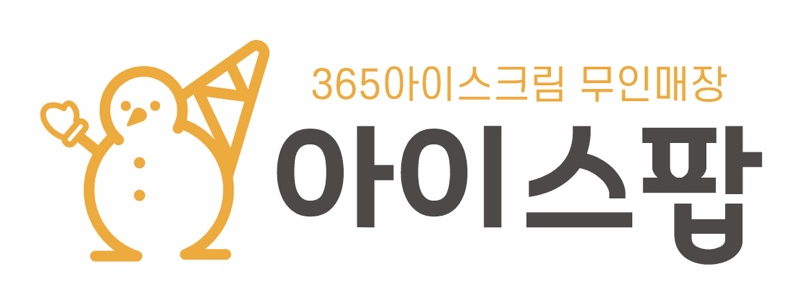

<h1 align="center">Icepop Workflow</h1>

무인 아이스크림 매장 2곳의 매출 수집부터 발주 추천까지, 사람 손을 거치지 않게 만든 n8n 자동화 <b>2026.05부터 실제 매장 운영에 쓰고 있습니다</b>

<code>n8n (self-hosted)</code> <code>Oracle Cloud ARM</code> <code>Docker</code> <code>Caddy(HTTPS)</code> <code>Google Sheets</code> <code>Looker Studio</code> <code>Kakao API</code>

<table>
<tr>
<td width="34%" align="center">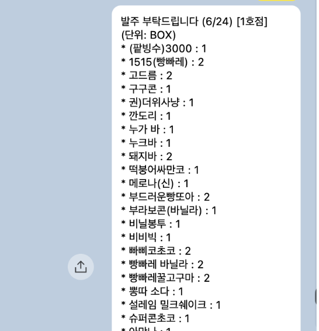 매주 수요일 아침 도착하는 발주 추천 카톡</td>
<td width="66%" align="center">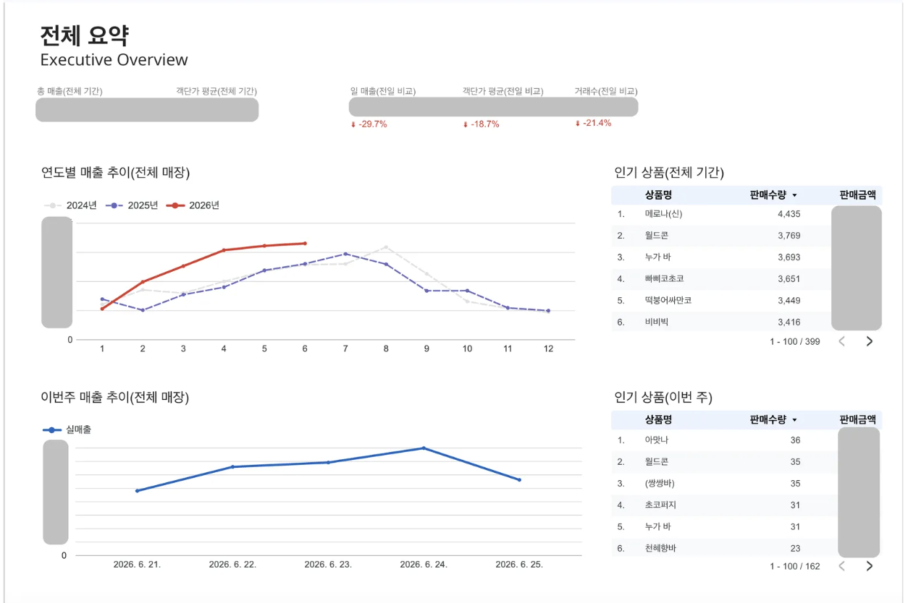 매일 쌓이는 매출로 만든 대시보드 (금액은 가림)</td>
</tr>
</table>

| 매주 발주 정리 | 매출 확인 | 매일 자동 적재 |
|:---:|:---:|:---:|
| **약 1시간 → 약 3분** | **매일 POS 접속 → 자동 수집** | **하루 약 100건** |

---

## 1. 무엇이 바뀌었나

매장 운영자는 매일 POS 사이트에 들어가 매출을 확인했고, 일주일에 한 번은 약 1시간씩 판매량을 보면서 발주 목록을 손으로 정리했습니다. 이 두 가지를 없애는 게 목표였습니다.

| | Before | After |
|---|---|---|
| 매출 확인 | 매일 POS 사이트에 접속해서 확인 | 매일 23:30 자동 수집 → 시트 적재 → 대시보드 |
| 발주 | 판매량 화면을 보며 품목별 박스 수를 직접 계산 | 수요일 09:10 추천 목록이 카톡으로 도착, 확인·수정만 하면 끝 |
| 데이터 | POS 화면 안에서만 볼 수 있음 | 시트에 쌓여서 연도별·매장별·상품별로 비교 가능 |

<table>
<tr>
<td width="50%" align="center">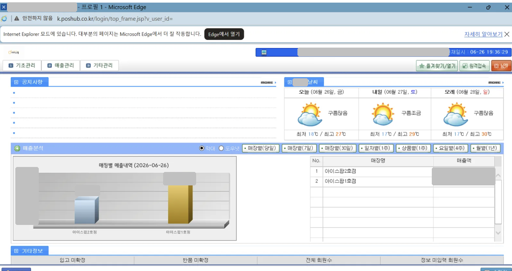 <b>Before</b> — API가 없는 레거시 JSP POS (IE 모드로만 열림)</td>
<td width="50%" align="center">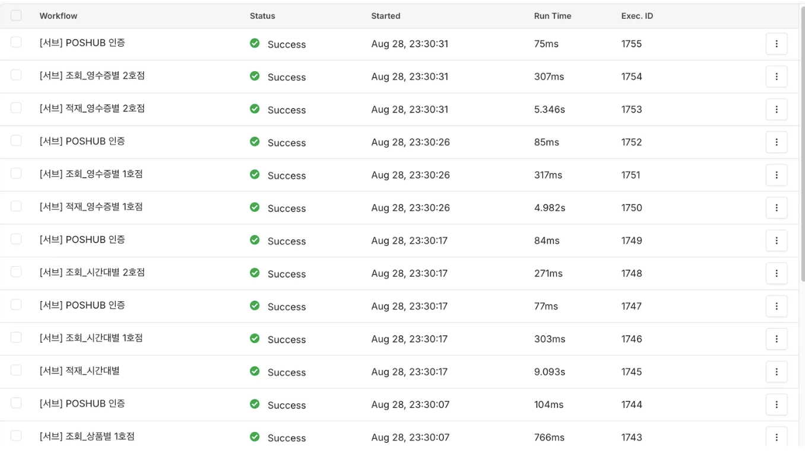 <b>After</b> — 매일 23:30 자동으로 도는 수집 워크플로우</td>
</tr>
</table>

## 2. 시스템 구조

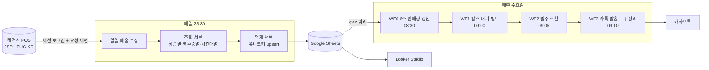

## 3. 왜 이렇게 설계했나

### ① 저장소는 DB가 아니라 Google Sheets
**데이터를 보고 고치는 사람이 개발자가 아니기 때문입니다.**
운영자가 직접 열어서 확인하고, 잘못된 값은 바로 고칠 수 있어야 했습니다. 시트는 Looker Studio와 바로 연결되고, 매장 2곳 규모에서는 DB를 따로 운영하는 부담이 더 큽니다.
대신 시트의 약점(중복, 조회 속도)은 아래 ②, ③으로 보완했습니다.

### ② 모든 적재는 유니크키 + upsert
**같은 날짜를 몇 번 다시 수집해도 데이터가 한 벌만 남아야 합니다.**
초기에는 단순 추가(Append)로 쌓다가 재실행이 겹치면서 시트가 약 6.5만 행까지 불어났고, 정리해 보니 실제 데이터는 6,058행이었습니다.
그 뒤로는 `매출일자_매장코드_바코드` 같은 키를 만들어 `Append or Update`로만 적재합니다. 덕분에 누락 구간을 다시 채우는 백필도 걱정 없이 반복 실행할 수 있습니다.

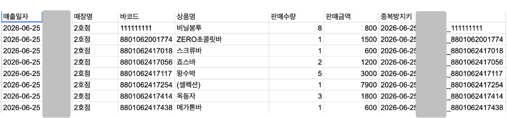
오른쪽 끝 '중복방지키' 컬럼이 upsert 기준 (매장코드는 가림)

### ③ 시트 전체 조회 대신 gviz 쿼리
**필요한 행만 받아야 API 제한에 걸리지 않습니다.**
판매 기록이 쌓이면서 n8n Google Sheets 노드로 읽는 방식은 한계에 부딪혔습니다(→ 트러블슈팅 ③). gviz 엔드포인트에 SQL 비슷한 쿼리를 보내면 HTTP 요청 한 번에 조건에 맞는 행만 받을 수 있습니다.

### ④ 발주 파이프라인을 4단계로 분리
**실패하면 어디서 멈췄는지 바로 알고, 그 단계만 다시 돌릴 수 있어야 합니다.**
집계(WF0) → 대기열(WF1) → 추천(WF2) → 발송(WF3)을 시간차를 두고 나눴습니다. 카톡 발송에 성공한 뒤에만 대기열을 정리하기 때문에, 발송이 실패해도 추천 결과가 사라지지 않습니다.

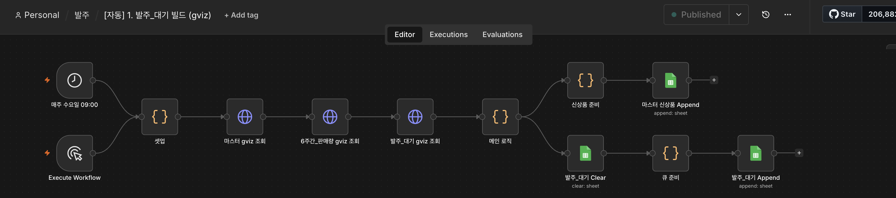
WF1 발주_대기 빌드 — gviz로 마스터·6주 판매량·대기열을 조회한 뒤 메인 로직에서 계산

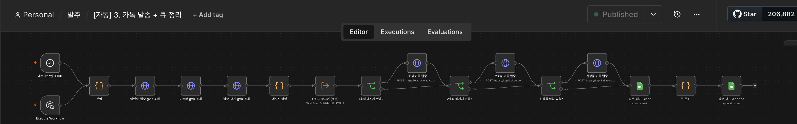
WF3 카톡 발송 + 큐 정리 — 매장별로 발송한 뒤 대기열 정리

### ⑤ 토큰 만료를 사람이 챙기지 않게
**먼저 만든 아로마포레스트 자동화에서 토큰 만료로 시스템이 멈춘 경험이 있어서, 이번에는 처음부터 막았습니다.**
Google 연동은 만료가 없는 서비스 계정으로 붙였고, 카카오 refresh_token은 워크플로우가 2주마다 스스로 갱신합니다.

## 4. 트러블슈팅

### ① API가 없는 레거시 POS에서 데이터 꺼내기
- **문제**: POS는 IE 모드에서만 열리는 오래된 JSP 사이트였고, 공개 API가 없었습니다.
- **분석**: 별도 PC에서 Fiddler로 브라우저가 주고받는 HTTP 요청을 캡처했습니다. 세션 쿠키(JSESSIONID)로 로그인 상태를 유지하고, 응답은 EUC-KR이며, **요청 순서와 값에 의존하는(stateful) 구조**라는 걸 확인했습니다. 예를 들어 조회 날짜는 첫 번째 요청 본문에만 넣고, 두 번째 요청에는 빈 값으로 보내야 정상 응답이 왔습니다.
- **해결**: 캡처한 요청을 그대로 n8n HTTP Request 노드로 재현해서, 사람이 화면에서 클릭하던 흐름을 서버에서 똑같이 수행하게 했습니다.

### ② 토큰 갱신 중 기존 토큰까지 사라진 사고
- **증상**: 어느 수요일 아침, 발주 카톡이 1·2호점 모두 발송되지 않았습니다. 토큰 시트를 열어 보니 헤더만 남아 있었습니다.
- **원인**: 토큰 갱신 워크플로우가 **시트 비우기(Clear) → 새 토큰 쓰기(Append)** 순서였는데, 쓰기 노드에 템플릿의 임시 시트 ID가 남아 있어서 쓰기만 실패했습니다. n8n 화면에는 시트 이름이 정상으로 보였지만 실제 저장값은 임시값이라 눈으로는 찾을 수 없었습니다. 카카오는 새 토큰을 발급하는 순간 이전 토큰을 무효화하기 때문에, 비우기만 성공한 시점에서 토큰이 사라진 셈이었습니다.
- **해결**: 실패한 실행 기록에 남아 있던 새 토큰을 꺼내 시트를 복구했고, 구조를 **비우기 없이 `토큰명` 기준 upsert 한 번**으로 바꿨습니다. 이제 쓰기가 실패해도 기존 토큰은 그대로 남습니다.
- **남긴 원칙**: "지우고 다시 쓰기"는 쓰기가 실패하면 원본까지 잃습니다. 파괴적인 순서 자체를 없애는 게 가장 확실한 방어입니다.

### ③ Google Sheets API 429 (요청 과다)
- **증상**: 발주 추천 워크플로우가 매주 수요일 `The service is receiving too many requests` 오류로 실패했습니다.
- **원인**: n8n Google Sheets 노드가 약 200개 품목을 행 단위로 반복 조회하면서 할당량을 넘었습니다.
- **해결**: gviz 쿼리로 HTTP 요청 한 번에 필요한 데이터를 받도록 다시 만들었습니다. 같은 시각에 gviz 버전은 정상 동작했고, 이전 버전은 비활성화했습니다. (설계 결정 ③의 계기)

### ④ "발주가 좀 과한 것 같다"는 피드백
- **증상**: 추천대로 발주하면 재고가 조금씩 쌓인다는 점주 피드백이 있었습니다. 두 달 동안은 티가 안 나다가 누적되면서 드러났습니다.
- **원인**: 코드를 다시 보니 **첫 박스를 넣는 기준**과 **박스를 하나 더 넣는 기준**이 따로 놀고 있었습니다. 첫 박스는 판매량이 박스 입수량의 일정 비율을 넘어야 들어가는데, 두 번째 박스부터는 올림(`Math.ceil`) 처리라서 조금만 넘어도 한 박스가 추가됐습니다. 예를 들어 40개들이 상품이 41개 팔리면 80개를 발주하는 식이었습니다.
- **해결**: 두 기준을 임계값 하나(`BOX_ADD_T`)로 통일했습니다. 이제 "박스 하나를 더 채울 만큼 팔렸는가"를 같은 기준으로 판단하고, 조정도 이 값 하나만 바꾸면 됩니다.

## 5. 워크플로우별 특징

| 워크플로우 | 특징 |
|---|---|
| `[자동] 일일 매출 수집` | 인증 → 조회 → 적재를 서브워크플로우로 쪼개서 매장 2곳 × 3종(상품별·영수증별·시간대별)을 같은 모듈로 처리 |
| `[서브] POSHUB 인증` | 매 호출마다 새 세션을 받아서 조회 서브에 쿠키로 넘김 |
| `[자동] 0. 6주간_판매량 갱신` | 최근 6주 판매량을 미리 집계해 두는 단계. 추천 로직이 원본 매출 전체를 읽지 않게 함 |
| `[자동] 2. 발주 추천 (gviz)` | 최근 판매량 ÷ 박스 입수량으로 박스 수 계산, 임계값 하나로 편입·추가 판단 |
| `[자동] 3. 카톡 발송 + 큐 정리` | 매장별·신상품 메시지를 따로 발송하고, 발송 후에만 대기열 정리 |
| `[백필] *` | 누락 구간을 날짜 지정으로 다시 채우는 수동 실행용. upsert라서 반복 실행해도 안전 |

## 6. 대시보드

<table>
<tr>
<td width="50%">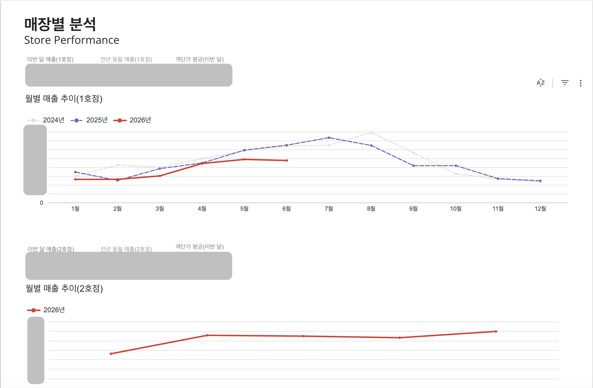</td>
<td width="50%">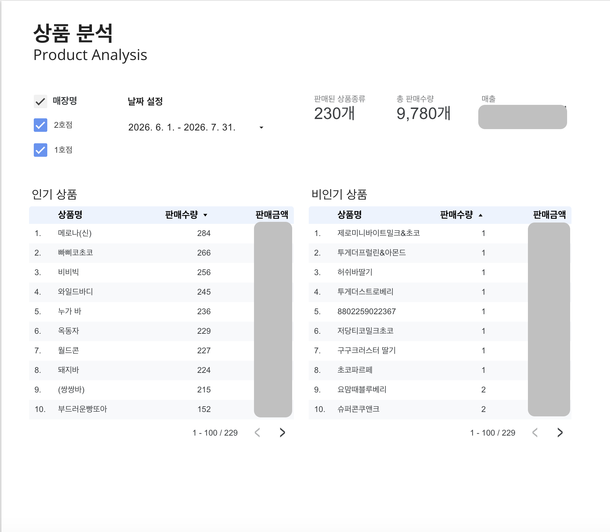</td>
</tr>
</table>

---

## 정리

이 시스템은 **"사람이 매일·매주 하던 일을 없앤다"**는 목표로 만들었고, 지금도 매일 밤 매출을 모으고 매주 수요일 발주 목록을 보냅니다.
설계 원칙은 세 가지입니다. **다시 돌려도 안전하게(upsert), 필요한 것만 읽게(gviz), 실패해도 원본은 남게(파괴적 순서 제거).** 각 원칙은 위 트러블슈팅에서 실제로 부딪히고 나서 정한 것입니다.

<b>파일 안내 · 그대로 가져다 쓰려면</b>

- `[자동] *` 스케줄로 도는 메인 워크플로우 / `[서브] *` 재사용 모듈 / `[백필] *` 누락 구간 복구 / `[수동] *`·`[문서] *` 최초 토큰 발급, 시스템 문서
- `images/` README 이미지 (개인정보·매출 금액은 가림)

보안을 위해 아래 값은 placeholder로 바꿔두었습니다. n8n에서 Import한 뒤 직접 채우거나 Credential로 옮겨서 쓰면 됩니다.

| placeholder | 의미 |
|---|---|
| `YOUR_ICEPOP_SHEET_ID` | Google Sheets 문서 ID |
| `STORE_CODE_1`, `STORE_CODE_2` | POS 매장 코드 |
| `{{POS_USER_ID}}`, `{{POS_PASSWORD}}` | POS 로그인 정보 |
| `{{KAKAO_REST_API_KEY}}`, `{{CLIENT_SECRET}}`, `{{AUTH_CODE}}` | 카카오 API 키 · 인가코드 |

Credential 연결 정보와 실행 데이터(pinData)는 내보낼 때 제거했습니다.

